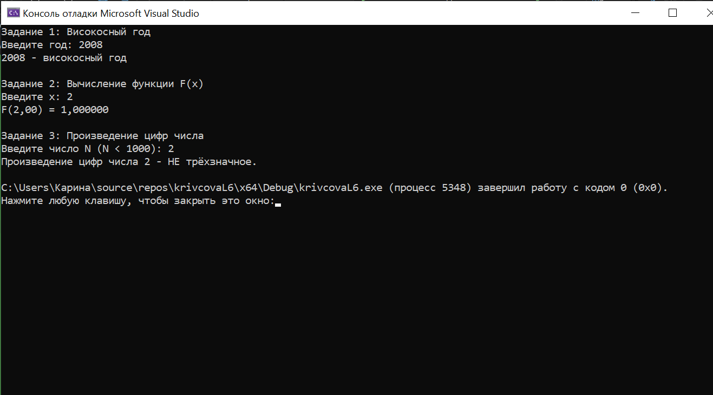
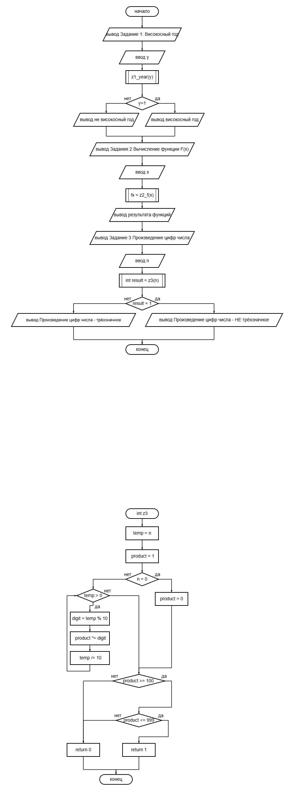

# Лабораторная работа 6

## Цель работы
Получение навыков  использования ветвлений в программах с использованием операторов if-else языка С и закрепления навыков использования арифметических операции 

## Результаты работы программы

## Блок-схема

## Информация о разработчике
Кривцова Инна Андреевна
Группа: бИД-262
